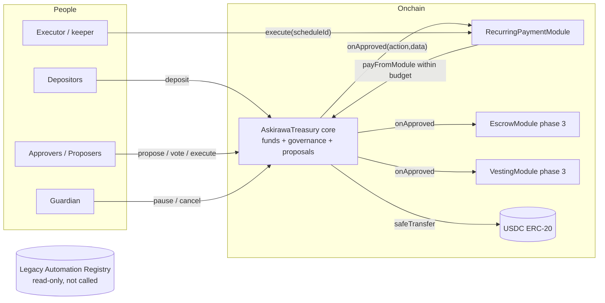
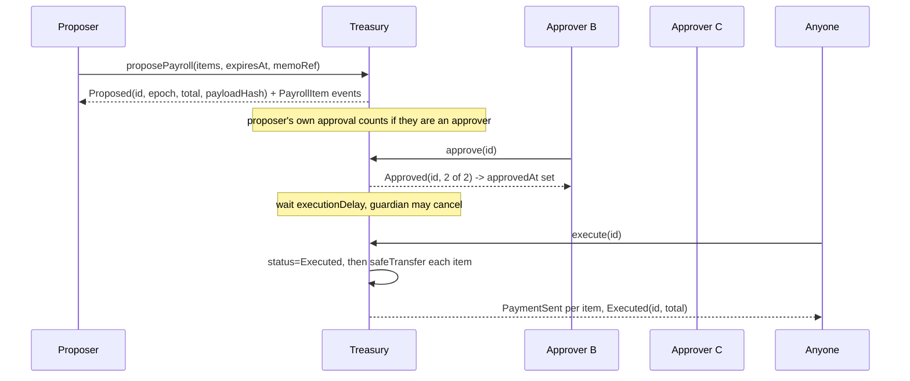
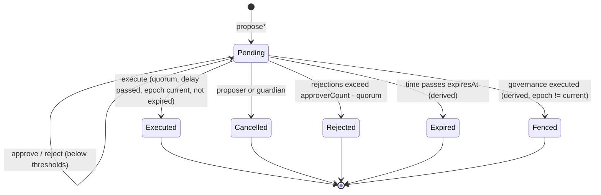

# Askirawa Treasury v2: Architecture and Security Design (Part 1 of 4: Core)

Parts: **1 Core (this file)** | [2 Modules](./TreasuryV2-modules-design.md) | [3 Security](./TreasuryV2-security-design.md) | [4 Delivery](./TreasuryV2-delivery-design.md)

## 1. Metadata

| Field | Value |
|---|---|
| Status | Draft rev 2, decisions D1, D5, D6, D15 resolved; D9 evaluated but undecided. No code written, nothing deployed. |
| Target chain | Arc Testnet first. Arc Mainnet (5042) only after audit, deployed by the owner outside Arc Studio. |
| Language / toolchain | Solidity 0.8.28 (checked arithmetic, matches the existing pinned scripts), Foundry, OpenZeppelin 5.x, Slither. |
| Asset | USDC only, through its ERC-20 interface (6 decimals). Address comes from `getUsdc(chainId)` in `@/onchain-facts`, never typed. |
| Inputs | `docs/initial-codebase-audit.md` |
| Review tracker | [ ] Design  [ ] Security  [ ] Ops  [ ] Data (indexing)  [ ] Compliance (USDC blocklist and pause behavior) |

Out of scope and untouched: the deployed Automation Registry `0x5E13b82A35Ac827b368215141F4a4F8ADfb1F434` (same address as the one in your brief, only the letter case differs), and the never-deployed v1 treasury. v2 shares no code path, storage or address with either.

## 2. Action items (living)

Review round 1 (decisions received):

| Item | Outcome | Where it landed |
|---|---|---|
| D1 minimum quorum | Resolved: 2. Hard-coded constant `MIN_QUORUM = 2` on every network, including testnet. At least 2 approvers always. | Part 1 sections 4, 10; Part 3 section 7; Part 4 tests |
| D5 payroll execution | Resolved: all-or-nothing. No partial mode, no skip flag, no per-item status. | Part 1 section 10.4; Part 3 section 4; Part 4 tests |
| D6 monthly schedules | Resolved: calendar-month arithmetic anchored to the start day, with explicit end-of-month rules and test vectors. | Part 2 section 2.4; Part 4 tests |
| D15 wallet addresses | Resolved: no addresses are invented anywhere. Roles are deployment inputs. Placeholders exist only in docs and tests and are labelled. | Part 1 section 11; Part 4 section 3 |
| D9 recovery | Open. Options A, A+, B-a, B-b, B-c, F evaluated side by side without choosing. Blocks contract implementation because the contracts are immutable. | Part 3 section 11; Part 4 sections 5 and 6 |

## 3. Goals and non-goals

Goals:
1. Every payment, approval and execution is an onchain fact that any approver can verify without trusting this app.
2. No single key can move or redirect funds. Compromise of fewer than quorum approvers cannot lose funds.
3. Recurring payments run without a human, using an executor that holds no authority over funds.
4. Small surface: typed actions only, no arbitrary calls, no upgrade admin.

Non-goals:
- Generic smart-account behavior (no arbitrary `call`, no `delegatecall`, no token swaps).
- Tokens other than USDC.
- Gasless or relayed voting (deferred, see Part 4 decisions).
- Replacing or modifying the legacy Automation Registry.
- Mainnet deployment by Arc Studio.

## 4. Requirements

Functional:
- F1 USDC deposit by anyone; balance readable onchain.
- F2 Payroll proposals with up to `MAX_PAYMENTS` recipients; single transfer is a payroll of one.
- F3 Configurable approver set and quorum, changed only by approved proposal. Quorum is never below `MIN_QUORUM` (2) and there are never fewer than 2 approvers.
- F4 Full proposal contents (every recipient, amount, total, expiry, delay, status) readable from contract state.
- F5 Cancel, reject, expire, execute with defined terminal states.
- F6 Recurring schedules, escrow and vesting as separate modules (Part 2).

Security (each is a testable assertion):
- S1 No function moves USDC except `executePayroll`/`execute` of an approved proposal, `payFromModule` within an enabled module budget, and `rescue` of non-USDC tokens by proposal.
- S2 A proposal executes at most once, and only with the approver set and quorum that were stored when it was created (epoch fence).
- S3 The executed payments are byte-for-byte the stored payload; no caller-supplied arrays at execution.
- S4 Votes are one per approver per proposal, immutable, and counted only against the creation-time snapshot.
- S5 No role can both propose and cancel others' proposals, nor both pause and unpause.
- S6 A module can never spend more than its budget in any window, even if the module is buggy.
- S7 Treasury USDC balance never falls by more than the sum of executed payments and module draws.
- S8 No deployment parameter and no governance proposal can set a quorum below 2 or an approver set smaller than 2.
- S9 A payroll proposal either pays every stored item or pays nothing and stays Pending (no partial execution state exists).

## 5. Terminology and actors

| Term | Meaning |
|---|---|
| Epoch | Version number of the governance configuration. Incremented by each executed governance proposal. Each epoch's approver set and quorum are stored forever and never edited. |
| Snapshot | The epoch, quorum and approver-set reference copied into a proposal at creation. |
| Fence | A proposal can execute only while `proposal.epoch == currentEpoch`. A governance change voids every pending proposal. |
| Module | A separate contract enabled by quorum, allowed to draw USDC within a budget. |
| Budget | Per-module `perTxMax` and `windowMax` per `windowLength`, enforced by the core, not by the module. |

| Actor | Where | Trust | Powers |
|---|---|---|---|
| Approver | wallet or Safe, onchain | semi-trusted, quorum-trusted | vote, reject, propose, pause, cancel schedules |
| Proposer | wallet, onchain | low | create proposals, cancel own pending proposal. No vote unless also an approver. |
| Guardian | wallet or Safe | low (cannot move funds) | pause, cancel pending payroll, module and rescue proposals. Cannot propose, vote, execute, unpause, or cancel governance and unpause proposals. |
| Executor / keeper | any address | untrusted | call `execute` on a due schedule or an approved proposal. No other power. |
| Depositor | any address | untrusted | deposit USDC |
| Module | contract | trusted only up to its budget | `payFromModule` |
| Owner | does not exist in v2 | | |

## 6. Language, runtime and standards

- Solidity 0.8.28, optimizer on, `via_ir` off unless stack-too-deep forces it. Cancun-level EVM features not required.
- Interfaces: ERC-20 (USDC), ERC-165 for module registration. OpenZeppelin: `SafeERC20`, `ReentrancyGuard` (transient variant only if Arc supports it, otherwise the storage one), `IERC165`.
- Smart-contract approvers (Safe) work because voting uses `msg.sender`; ERC-1271 is not needed in v2.
- Arc specifics: gas is USDC. The ERC-20 balance and the native balance are one pool. The treasury has no `receive` or `fallback` and never handles `msg.value`; accounting uses only `usdc.balanceOf(address(this))`.
- Execution is atomic per transaction. Re-entry surface: USDC transfers (no callbacks on USDC) and the module callback `onApproved`. All state-changing external entry points are `nonReentrant` and follow checks, effects, interactions.

## 7. Contract boundaries (summary)

| Contract | Responsibility | Holds funds? | Upgradeable? |
|---|---|---|---|
| `AskirawaTreasury` (core) | funds, governance epochs, proposal engine (payroll, governance, module config, rescue, unpause, module action), module budgets, pause | yes (all treasury USDC) | no (immutable) |
| `RecurringPaymentModule` | schedules, conditions, execution, retries (also covers "automation rules") | no | no |
| `EscrowModule` (phase 3) | conditional hold and release of treasury-funded escrows | only funded escrows | no |
| `VestingModule` (phase 3) | prefunded linear/cliff vesting grants | only funded grants | no |
| `ScheduleMath` (internal library) | daily/weekly/calendar-month due-time arithmetic | n/a | n/a |

Decisions behind the split:
- **Payroll stays in the core.** It is the approval engine's main product, it shares the proposal lifecycle, and a separate payroll contract would need its own copy of governance or a trust link back to the core. The existing `PayrollBatch` becomes unnecessary.
- **Transfer is payroll of one.** Removes a proposal type and a code path.
- **Automation is a feature of the schedule module, not a third contract.** Rules in v2 can only do "pay fixed recipient a fixed amount" under conditions. Arbitrary-call rules (as the legacy registry's interface implies) are rejected: they would give a keeper unbounded authority.
- **Escrow and vesting are separate modules.** Different state machines and different trust (escrow depends on a release decision, vesting on time). Combining them would enlarge each audit for no shared benefit. Both are phase 3, after core and schedules are proven on testnet.
- **One governance engine.** Modules do not have their own voting; module changes go through core proposals (type `MODULE_ACTION`), so there is one approver set to secure and monitor.

## 8. Architecture



Governance sequence (payroll):



## 9. Flow of funds

| Step | Who moves what | Invariant |
|---|---|---|
| Deposit | depositor pulls own USDC into core via `deposit(amount)` or plain ERC-20 transfer | balance rises by exactly `amount` |
| Payroll execute | core sends each stored item to its recipient | balance falls by exactly `totalAmount` (balance-delta asserted), status already `Executed` |
| Module draw | module calls `payFromModule`, core sends to recipient or to the module's custody (escrow/vesting funding) | `amount <= perTxMax`, window spend `<= windowMax`, module enabled, not paused |
| Escrow/vesting release | module sends to a fixed beneficiary or back to core | only to addresses fixed at creation |
| Rescue | core sends a non-USDC token to a proposal-approved address | token != USDC |

Resting-state invariant: the core holds only USDC; every USDC unit that left the core is explained by an `Executed` payroll, a `ModulePaid` event, or an approved migration payroll.

## 10. Core contract design

### 10.1 Roles (per epoch, stored in the epoch config)

| Role | Count | Permissions | Why |
|---|---|---|---|
| Approver | 2 to `MAX_APPROVERS` (20), never fewer than 2 | vote, reject, propose, pause, cancel schedules | decision makers |
| Proposer | 0 to 50, may overlap approvers | propose, cancel own | lets finance staff prepare without voting power |
| Guardian | 0 or 1 | pause, cancel any non-executed proposal | fast brake with zero ability to move funds |
| Quorum | `MIN_QUORUM` (2) to approver count | threshold | `MIN_QUORUM` is a compile-time constant (D1). Four-eyes review holds on every network; testnet needs at least 2 approver wallets |

There is no owner, no `Ownable`, and no function that bypasses quorum. Guardian replacement is a governance proposal; the new guardian need not accept because the role cannot move funds (deliberate deviation from two-step role transfer, recorded in Part 3).

### 10.2 Storage

```solidity
IERC20 public immutable usdc;
uint8   public constant MIN_QUORUM = 2;       // D1: fixed in code, identical on every network
uint256 public currentEpoch;                  // starts at 1
bool    public paused;
uint256 public nextProposalId;                // sequential, contract-assigned

struct Epoch {                                 // written once, never edited
    uint8   quorum;
    uint32  payrollDelay;                      // seconds between quorum and executable
    uint32  configDelay;                       // >= minConfigDelay (immutable floor)
    address guardian;
    address[] approvers;
    address[] proposers;
    uint64  createdAt;
}
mapping(uint256 => Epoch) private _epochs;
mapping(uint256 => mapping(address => uint8)) public roleFlags; // epoch => addr => bit0 approver, bit1 proposer

enum Action   { None, Payroll, Governance, ModuleConfig, ModuleAction, Rescue, Unpause }
enum Status   { None, Pending, Executed, Cancelled, Rejected }  // Approved and Expired are derived

struct Proposal {
    Action  action;
    Status  status;
    uint64  epoch;            // snapshot
    uint8   quorum;           // snapshot copy for cheap reads
    address proposer;
    uint64  createdAt;
    uint64  approvedAt;       // 0 until quorum reached
    uint64  executableAt;     // approvedAt + delay, 0 until approved
    uint64  expiresAt;
    uint16  approvals;
    uint16  rejections;
    uint96  totalAmount;      // payroll and module funding total, else 0
    bytes32 payloadHash;      // keccak256(payload)
    bytes32 memoRef;          // opaque reference (invoice id, hash of off-chain note)
}
mapping(uint256 => Proposal) public proposals;
mapping(uint256 => bytes)    private _payload;        // full ABI-encoded payload, readable via views
mapping(uint256 => mapping(address => uint8)) public voteOf; // 1 approve, 2 reject

struct Payment { address to; uint96 amount; }          // one storage slot each
// Payroll payload = abi.encode(Payment[]). Other actions encode their own typed structs.

struct ModuleConfig { bool enabled; bytes32 codehash; uint96 perTxMax; uint96 windowMax;
                      uint32 windowLength; uint64 windowStart; uint96 windowSpent; }
mapping(address => ModuleConfig) public modules;
```

Layout rule: contract is immutable, so no layout-compatibility constraint. Migration is by contract switch (Part 4).

### 10.3 Write functions

| Function | Caller | State change | Events | Reverts when |
|---|---|---|---|---|
| `constructor(usdc, minConfigDelay, approvers[], proposers[], quorum, guardian)` | deployer, once | epoch 1 stored | `EpochCreated` | zero or duplicate addresses, fewer than 2 approvers, quorum below `MIN_QUORUM` or above approver count, usdc has no code |
| `deposit(amount)` | anyone | pulls USDC | `Deposited` | `amount==0` |
| `proposePayroll(items[], expiresAt, memoRef)` | proposer or approver | new Pending proposal, payload stored, proposer auto-approves if approver | `Proposed`, `PayrollItem` per item, `Voted` | not proposer, 0 or `>MAX_PAYMENTS` items, zero or self address, zero amount, total overflow, expiry outside `[now+minWindow, now+30d]` where `minWindow = delay + 1h` |
| `proposeGovernance(newEpochConfig, expiresAt, memoRef)` | proposer or approver | as above, payload = new config | `Proposed`, `GovernanceItem` | duplicates, fewer than 2 approvers, quorum `< MIN_QUORUM` or `> approver count`, approver count `>20`, delay below floor |
| `proposeModuleConfig(module, enabled, perTxMax, windowMax, windowLength, expiresAt, memoRef)` | proposer or approver | as above | `Proposed` | module not ERC-165 compliant, no code, `perTxMax > windowMax` |
| `proposeModuleAction(module, actionCode, data, fundingAmount, expiresAt, memoRef)` | proposer or approver | as above, funding amount is part of total | `Proposed` | module not enabled, funding above `perTxMax` |
| `proposeRescue(token, to, amount, expiresAt, memoRef)` | proposer or approver | as above | `Proposed` | `token == usdc`, zero address |
| `proposeUnpause(expiresAt, memoRef)` | proposer or approver | as above | `Proposed` | not paused |
| `approve(id)` | approver in snapshot epoch | `voteOf`, `approvals++`; when `approvals >= quorum` sets `approvedAt`, `executableAt` | `Voted`, `QuorumReached` | not Pending, expired, wrong epoch, not in snapshot set, already voted |
| `reject(id)` | approver in snapshot epoch | `rejections++`; when `rejections > approverCount - quorum` status Rejected | `Voted`, `Rejected` | same as approve |
| `cancel(id)` | proposer of that proposal, or guardian (guardian not allowed on Governance and Unpause proposals) | status Cancelled | `Cancelled(id, by)` | status not Pending, already executed, guardian on a protected action |
| `execute(id)` | anyone | see 10.4 | per action | see 10.4 |
| `pause()` | guardian or any current approver | `paused = true` | `Paused` | already paused |
| `payFromModule(to, amount, ref)` | enabled module only | window accounting, transfer | `ModulePaid` | not module, codehash changed, paused, budget exceeded, `to` is zero or the core |
| `fundModule(amount, ref)` | enabled module only | same budget, sends USDC to the calling module | `ModuleFunded` | same |

All `propose*`, `approve`, `reject`, `execute`, `payFromModule`, `fundModule` are `nonReentrant`.

Read functions: `getProposal(id)`, `getPayload(id)` (raw), `getPayroll(id, offset, limit)` (decoded, paginated), `getEpoch(epoch)`, `isApprover(addr)`, `isApproverAt(epoch, addr)`, `quorum()`, `approvers()`, `status(id)` (adds derived Approved/Expired/Executable), `votes(id)` (list of voters), `balance()`, `moduleSpendRemaining(module)`.

### 10.4 Execution (`execute(id)`)

```
require status == Pending
require now < expiresAt
require proposal.epoch == currentEpoch                 // fence
require approvals >= proposal.quorum                   // snapshot quorum
require now >= executableAt
if action != Governance && action != Unpause: require !paused
status = Executed                                      // effects before interactions
switch action:
  Payroll:      items = abi.decode(_payload[id]); assert sum == totalAmount
                before = usdc.balanceOf(this); require before >= total
                for each item: usdc.safeTransfer(to, amount); emit PaymentSent(id, i, to, amount)
                assert before - usdc.balanceOf(this) == total
  Governance:   write new Epoch; currentEpoch++; emit EpochCreated (all pending proposals are now fenced)
  ModuleConfig: update ModuleConfig, store extcodehash on enable
  ModuleAction: fund module (budget-checked), then module.onApproved(id, actionCode, data)
  Rescue:       token.safeTransfer(to, amount)
  Unpause:      paused = false
emit Executed(id, action, total)
```

Any revert undoes everything including the `Executed` flag, so a failed attempt can be retried until expiry. No caller-supplied arrays exist, so payload substitution is impossible by construction.

**Payroll is all-or-nothing (D5).** There is one execution path for payroll: every stored item is transferred in a single transaction, and if any transfer reverts (for example USDC refuses a recipient), the whole call reverts, nothing moves, and the proposal stays Pending until it is cancelled, expires, or the cause clears. The contract has no `atomic` flag, no skip-failed-item option, no per-item status and no partial-payment event. Recovery from a bad recipient is: cancel, re-propose without it, collect votes again. The UI reduces how often this happens with pre-flight checks (valid address, not the treasury itself, simulation of the execution call before showing "Executable"), but those checks are advisory; the contract rule is the guarantee.

### 10.5 Proposal lifecycle



Derived states are computed by `status(id)`; they never need a transaction. Proposal ids are sequential and assigned by the contract, so there are no caller-chosen ids to squat or replay.

## 11. Deployment configuration and address policy (D15)

No wallet address is invented, defaulted or hard-coded in the contracts, the frontend, the tests or these documents. Every role is a deployment input supplied by you.

| Item | Rule |
|---|---|
| Role inputs | Approvers, proposers, guardian, quorum, `minConfigDelay` and (if D9 adds it) the recovery roles are read from a deployment config file or environment variables at deploy time, for example `APPROVERS`, `PROPOSERS`, `GUARDIAN`, `QUORUM`. Names are illustrative; the config shape is finalized with the deploy script. |
| Deploy script checks | Refuses to run if any address is zero, duplicated across a role, malformed, or equal to a documented placeholder; refuses a quorum below 2 or fewer than 2 approvers; prints the full resolved configuration and requires explicit confirmation before broadcasting (never run by Arc Studio on mainnet). |
| Shared platform wallet | Never used as an approver, proposer, guardian, recipient or recovery signer. |
| Docs and examples | Placeholders are written as `<APPROVER_1_ADDRESS>`, `<APPROVER_2_ADDRESS>`, `<GUARDIAN_ADDRESS>`, `<RECIPIENT_1_ADDRESS>` and so on, always in angle brackets so they cannot be mistaken for real values. |
| Foundry tests | Test accounts come from Foundry's `makeAddr("approver1")` style helpers or constants named `PLACEHOLDER_*`. They exist only under `contracts/test/` and are rejected by the deploy script's placeholder check. |
| Frontend | Holds no role addresses. It reads approvers, proposers, guardian and quorum from the contract. `.env` contains only contract addresses and the deploy block, which come from the deployment receipt. |
| Testnet | Needs at least 2 approver wallets (D1), plus whichever proposer, guardian and recipient wallets you want to exercise. You provide them or tell Arc Studio to generate throwaway testnet wallets for the integration run; generated wallets are labelled test-only and never reused. |
