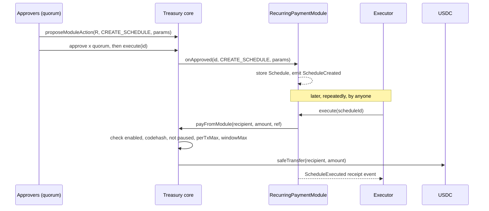

# Askirawa Treasury v2: Modules (Part 2 of 4)

Parts: [1 Core](./TreasuryV2-design.md) | **2 Modules (this file)** | [3 Security](./TreasuryV2-security-design.md) | [4 Delivery](./TreasuryV2-delivery-design.md)

This part owns recurring payments, the automation model, the executor security model, and the later escrow and vesting modules. Terminology (epoch, budget, fence) is defined in Part 1.

## 1. How a module relates to the core



Three independent layers limit what a schedule can do:
1. **What was approved.** Recipient, amount, frequency, limits and executor are fixed in the proposal payload. There is no edit function; a change means cancel and create anew.
2. **Module code.** Pays only the stored recipient and amount, once per due period.
3. **Core budget.** Even a buggy or malicious module cannot exceed `perTxMax` per call or `windowMax` per `windowLength`, and cannot act when the core is paused.

Module registration rules (core, via `ModuleConfig` proposal):
- Module must answer ERC-165 for `ITreasuryModule` and hold code. Its `treasury()` must equal the core.
- The core stores `extcodehash` at enablement and re-checks it on every `payFromModule`/`fundModule`.
- Modules have no owner, no admin, no upgrade path, and no function that moves funds except through the core.
- Disabling a module (or `pause()` on the core) stops all of its outflows immediately; schedule state is preserved.

```solidity
interface ITreasuryModule is IERC165 {
    function treasury() external view returns (address);
    /// Called only by the core while executing an approved MODULE_ACTION proposal.
    function onApproved(uint256 proposalId, uint8 actionCode, bytes calldata data) external;
}
```

## 2. RecurringPaymentModule

### 2.1 Types and storage

```solidity
enum Frequency      { Daily, Weekly, Monthly }
enum ScheduleStatus { None, Active, Paused, Cancelled, Completed }

struct ScheduleParams {            // abi-encoded inside the approved proposal
    address recipient;
    uint96  amount;                // per execution, 6-decimal USDC
    Frequency frequency;
    uint64  startTime;             // earliest first execution
    uint64  endTime;               // 0 = none
    uint32  maxExecutions;         // 0 = none
    uint96  maxTotal;              // 0 = none
    uint96  minTreasuryBalanceAfter; // 0 = none
    address executor;              // 0 = anyone may call execute
    bytes32 memoRef;               // opaque label/invoice hash
}

struct Schedule {
    address recipient;  uint96 amount;                       // slot 1
    uint64  startTime;  uint64 nextDue;  uint64 nextRetryAt; // effective start, next due, retry gate
    uint64  endTime;    Frequency frequency; ScheduleStatus status;
    uint32  executedCount; uint32 maxExecutions; uint8 failures;
    uint96  totalPaid;  uint96 maxTotal;  uint96 minTreasuryBalanceAfter;
    address executor;   uint64 createdByProposal; bytes32 memoRef;
}

address public immutable treasury;
uint256 public nextScheduleId;                       // sequential
mapping(uint256 => Schedule) public schedules;
// Tunables set at construction, bounded constants
uint32 public immutable retryDelay;       // seconds between failed attempts, >= 1 hour
uint8  public immutable maxFailures;      // consecutive failures before auto-pause, 1..10
uint8  public constant  MAX_BACKLOG = 3;  // due periods allowed to be outstanding
```

### 2.2 Write functions

| Function | Caller | State change | Events | Reverts when |
|---|---|---|---|---|
| `onApproved(id, CREATE_SCHEDULE, params)` | core only | new Active schedule. Effective start = `max(startTime, now)`. `nextDue = effective start`. | `ScheduleCreated` | zero or self/core/module recipient, zero amount, `amount > perTxMax` of this module, `startTime > now + 366 days`, `endTime <= start`, `maxTotal < amount`, bad frequency |
| `onApproved(id, RESUME_SCHEDULE, (scheduleId, skipMissed))` | core only | Paused to Active; if `skipMissed`, `nextDue` jumps to the first period boundary after now (skipped count logged), else unchanged | `ScheduleResumed` | not Paused |
| `execute(scheduleId)` | anyone, or only `executor` if set (approvers may always call) | pays one period or records a failure, see 2.3 | `ScheduleExecuted` or `ExecutionFailed`, `ScheduleAutoPaused`, `ScheduleCompleted` | not Active, not due, before `nextRetryAt`, caller not permitted |
| `pause(scheduleId)` | any current approver or the guardian | Active to Paused | `SchedulePaused(by)` | not Active |
| `cancel(scheduleId)` | any current approver or the guardian | Active/Paused to Cancelled (terminal) | `ScheduleCancelled(by)` | already terminal |

Why pause and cancel are single-signer but resume is quorum: stopping money is the safe direction and must be fast; restarting money is a spending decision and must be approved. A rogue approver can only stall payments, not redirect them, and quorum can resume.

Reads: `getSchedule(id)`, `isDue(id)`, `dueSchedules(offset, limit)` (ids currently executable, for keepers), `nextDueAt(id)`, `remaining(id)` (executions and amount left).

### 2.3 `execute(scheduleId)` pseudocode

```
s = schedules[id]
require s.status == Active
require now >= s.nextDue && now >= s.nextRetryAt
require s.executor == 0 || msg.sender == s.executor || ITreasury(treasury).isApprover(msg.sender)

// Hard stops (state change, no payment)
if s.endTime != 0 && s.nextDue > s.endTime              -> status=Completed; emit ScheduleCompleted; return
if s.maxExecutions != 0 && s.executedCount >= s.maxExecutions -> Completed; return
if s.maxTotal != 0 && s.totalPaid + s.amount > s.maxTotal      -> Completed; return

// Backlog guard: more than MAX_BACKLOG periods overdue means the keeper was down; require human review
if ScheduleMath.add(s.startTime, s.frequency, s.executedCount + MAX_BACKLOG) <= now
                                                        -> status=Paused; emit ScheduleAutoPaused(BACKLOG); return

// Soft conditions (no payment, counted as a failed attempt)
if minTreasuryBalanceAfter != 0 && usdc.balanceOf(treasury) < amount + minTreasuryBalanceAfter -> fail(CONDITION)

nonReentrant:
try ITreasury(treasury).payFromModule(s.recipient, s.amount, ref(id, s.executedCount)) {
    period       = s.executedCount
    dueAt        = s.nextDue
    s.executedCount += 1
    s.totalPaid     += s.amount
    s.failures       = 0
    s.nextRetryAt    = 0
    s.nextDue        = ScheduleMath.add(s.startTime, s.frequency, s.executedCount)   // anchored to start, no drift
    emit ScheduleExecuted(id, period, s.recipient, s.amount, dueAt, now, msg.sender, s.totalPaid)
    if limits now reached: status=Completed; emit ScheduleCompleted
} catch (bytes memory reason) {
    s.failures += 1
    s.nextRetryAt = now + retryDelay
    emit ExecutionFailed(id, s.executedCount, classify(reason), s.failures, s.nextRetryAt)
    if s.failures >= maxFailures: status=Paused; emit ScheduleAutoPaused(FAILURES)
}
```

Duplicate-execution protection: `executedCount` is the period index and only increments inside the success branch; a second call for the same period finds `nextDue` in the future and reverts `NotDue`. Re-entrancy cannot double pay because `execute` is `nonReentrant` and the core's `payFromModule` is `nonReentrant` too. The payment and the counter move together: the counter only advances if `payFromModule` returned without reverting.

Failure classes (`classify`): `PAUSED`, `BUDGET`, `INSUFFICIENT_BALANCE`, `TOKEN_REVERT` (for example USDC rejecting the recipient), `CONDITION`, `OTHER`. Unknown revert data maps to `OTHER` and is never decoded as trusted input.

Safe retries: a failed attempt changes nothing about the period. Retries are rate limited by `retryDelay`, capped by `maxFailures`, and need no special call: the same `execute` is simply tried again. Griefing check: a third party can only add one failure per `retryDelay`, and only while the payment would fail for the legitimate keeper at that moment anyway. The worst case is that auto-pause arrives at the fastest possible rate rather than at the keeper's polling rate. Recommended defaults: `retryDelay` 6 hours, `maxFailures` 5.

### 2.4 `ScheduleMath` (D6 resolved: calendar months, explicit end-of-month rules)

All arithmetic is in UTC seconds. There is no time zone and no daylight-saving handling. The UI always labels schedule times as UTC.

- **Daily:** period `n` is due at `start + n * 86400`.
- **Weekly:** period `n` is due at `start + n * 604800`.
- **Monthly (calendar month):**
  1. Take the effective start timestamp `T0` and split it into year `Y0`, month `M0`, day-of-month `D0` (the anchor day, 1 to 31) and seconds-of-day `S0`.
  2. Period `n` (with `n = 0` being the effective start itself) is due in calendar month `M0 + n`, carrying into later years.
  3. The due day is `min(D0, daysInMonth(year, month))`. A schedule anchored on the 29th, 30th or 31st therefore pays on the last day of any shorter month.
  4. The due time of day is `S0`, unchanged.
  5. Every period is computed from the anchor, never from the previous due date, so clamping never accumulates: an anchor of 31 January pays 28 February, then 31 March (not 28 March).
- **Leap years:** Gregorian rule. A year is a leap year if divisible by 4, except years divisible by 100 that are not divisible by 400 (so 2100 is not a leap year, 2400 is).
- **Effective start:** if the approved `startTime` is already in the past when the proposal executes, the effective start is the execution time, and the anchor day and time-of-day come from that moment. Approvers who care about the anchor day should set a future `startTime`; the UI warns when the approval window could pass the start.
- **Skip-missed on resume:** the first period after now is found by estimating the month difference and correcting by at most one step in either direction; the function never loops over every missed period.
- **Bounds:** `n` is limited by `maxExecutions` or `uint32`, and the function reverts if the result would exceed year 9999 or overflow `uint64`.
- **Frequency enum semantics are fixed in code:** `Monthly` always means calendar month. There is no 30-day option in v2. The legacy registry's 2592000-second value is shown as "30 days" in the Legacy panel and, when recreated, the proposal screen shows the calendar-month dates the approvers are voting on.

Reference vectors (all UTC; these become the Foundry cases M-MATH-02 and M-MATH-03 in Part 4):

| Anchor (effective start) | n | Due date | Rule demonstrated |
|---|---|---|---|
| 2027-01-31 09:00 | 0, 1, 2, 3, 4, 5 | 01-31, 02-28, 03-31, 04-30, 05-31, 06-30 (all 09:00) | clamp to last day, recovery to day 31, no accumulation |
| 2027-01-30 09:00 | 1, 2 | 2027-02-28, 2027-03-30 | day 30 clamps only in February |
| 2027-01-29 09:00 | 1 | 2027-02-28 | non-leap February |
| 2028-01-31 09:00 | 1, 2 | 2028-02-29, 2028-03-31 | leap February |
| 2028-02-29 09:00 | 12, 24, 48 | 2029-02-28, 2030-02-28, 2032-02-29 | leap-day anchor falls back, returns in a leap year |
| 2027-12-31 23:59:59 | 1, 2 | 2028-01-31, 2028-02-29 | year carry, last second of day preserved |
| 2100-01-31 00:00 | 1 | 2100-02-28 | century year is not a leap year |
| 2400-01-31 00:00 | 1 | 2400-02-29 | 400-year rule |
| 2027-03-15 12:00 | 0 to 3 | 03-15, 04-15, 05-15, 06-15 | ordinary day-15 anchor |

The function is pure, has no storage, and is fuzzed against an independent reference implementation over anchors and `n` ranges that include every month length and leap-year boundary.

### 2.5 Events

| Event | Parameters | Purpose |
|---|---|---|
| `ScheduleCreated` | `scheduleId` (indexed), `proposalId` (indexed), `recipient` (indexed), `amount`, `frequency`, `startTime`, `effectiveStart`, `endTime`, `maxExecutions`, `maxTotal`, `minTreasuryBalanceAfter`, `executor`, `memoRef` | complete record of what was approved |
| `ScheduleExecuted` | `scheduleId` (indexed), `periodIndex`, `recipient` (indexed), `amount`, `dueAt`, `executedAt`, `executor` (indexed), `totalPaid` | the payment receipt |
| `ExecutionFailed` | `scheduleId` (indexed), `periodIndex`, `reasonCode`, `failures`, `nextRetryAt` | failure record |
| `ScheduleAutoPaused` | `scheduleId` (indexed), `reasonCode` | alerting |
| `SchedulePaused` / `ScheduleResumed` / `ScheduleCancelled` / `ScheduleCompleted` | `scheduleId` (indexed), `by` / `skippedPeriods` | lifecycle |

## 3. Automation architecture

In v2, "automation rule" and "recurring schedule" are one object. A rule is a schedule plus conditions, and its only action is "pay this fixed recipient this fixed amount". This is the whole connection between automation and treasury execution.

| Rule element | Design |
|---|---|
| Creation and authorization | Only via an approved `MODULE_ACTION` proposal. No individual wallet can create a rule. |
| Triggers | Time only: start, frequency, end. |
| Conditions | `endTime`, `maxExecutions`, `maxTotal`, `minTreasuryBalanceAfter`. All fixed at creation. |
| Execution limits | Per rule: one period per call, `maxExecutions`, `maxTotal`. Per module: `perTxMax`, `windowMax` enforced by the core. Global: core pause. |
| Replay protection | Period index equals `executedCount`; each period can pay once. Ids are sequential. |
| Execution records | `ScheduleExecuted` and `ExecutionFailed` events plus counters in storage. |
| Failure handling | Section 2.3: soft-fail with rate-limited retry, auto-pause after `maxFailures` or backlog above `MAX_BACKLOG`. |
| Pause and cancel | Section 2.2: single approver or guardian; resume only by quorum. |
| Not supported | Rules that call arbitrary contracts, oracle or price conditions, conditions read from other contracts. These would give an executor unbounded reach; they may be added later as a separate, separately audited module. |

### Legacy Automation Registry

`0x5E13b82A35Ac827b368215141F4a4F8ADfb1F434` is never called, replaced or modified by v2. It is a legacy record store with unverified source and unknown access control; v2 neither trusts its data nor depends on it. The frontend may read its four records and show them in a read-only "Legacy" panel. A "Recreate as schedule" action maps fields into a normal v2 proposal that the approvers then review and vote on:

| Registry field | v2 field | Note |
|---|---|---|
| `recipient` | `recipient` | |
| `amount` | `amount` | already 6 decimals |
| `frequency` (86400 / 604800 / 2592000) | `Frequency` Daily / Weekly / Monthly | 2592000 is 30 days; v2 Monthly is a calendar month with end-of-month clamping (section 2.4). The recreate screen shows the actual upcoming dates so approvers confirm the difference |
| `executionTime` | `startTime` | past times are clamped to "now" (records 1 and 2 are dated 2026-10-02) |
| `name`, `note` | off-chain label, hashed into `memoRef` | |
| `owner`, `active` | ignored | |

## 4. Executor / keeper security model

The executor is an ordinary account. It is never a role in the core.

| Question | Answer |
|---|---|
| What can it do? | Call `execute(scheduleId)` on a schedule that is due. Nothing else. |
| Can it choose recipient, amount or timing? | No. Recipient and amount are stored; execution is only possible when due; it cannot pay earlier or twice. |
| Can it hold funds? | No. USDC goes from the core directly to the recipient. The executor only needs gas. |
| Can it pause, cancel, vote or change config? | No. |
| What if it is malicious or its key leaks? | It can only trigger payments that are already due and approved, at the earliest moment they are due. Possible nuisance: spend its own gas, trigger a failure record (rate limited). |
| What if it goes offline? | Payments are late, not lost. Anyone (including an approver from the UI) can call `execute`. After more than `MAX_BACKLOG` overdue periods the schedule auto-pauses. |
| Restricted mode | A schedule may name one `executor`; then only that address and the approvers may call it. Default is open (`0x0`) because it removes keeper trust and single points of failure. |

Off-chain keeper service (to be built in phase 4, hosted outside the Arc Studio sandbox):
- Reads `dueSchedules` each interval, sends one `execute` per due id, never batches different recipients into one signed payload.
- Uses its own hot wallet funded only with gas USDC. Its key lives in a secret manager as `KEEPER_PRIVATE_KEY`, never in the repo or chat.
- Idempotent: on any ambiguity it re-reads chain state before retrying. Transactions that revert because the period was already paid cost only gas.
- Emits metrics: due count, lag, failures by reason, wallet balance.

Maximum damage if a module is compromised: `windowMax` per `windowLength` until a guardian or approver calls `pause()` on the core. Budgets are therefore sized deliberately small (Part 3, section on parameters).

## 5. EscrowModule (phase 3, outline)

Purpose: hold treasury money against a milestone or deadline, then release to a fixed beneficiary or return to the core.

| Item | Design |
|---|---|
| Create | `MODULE_ACTION CREATE_ESCROW(beneficiary, milestones[] amounts, deadline, memoRef)`; core funds the module via `fundModule(total)` (budget-checked); module stores the escrow. |
| Release | `MODULE_ACTION RELEASE(escrowId, milestoneIndex)` approved by quorum; pays the fixed beneficiary only. |
| Refund | After `deadline + refundGrace`, anyone may call `refund(escrowId)`; remaining funds return to the core address only. |
| Dispute | No arbitrator in v2. Governance decides by proposal; unresolved funds return to the core after the deadline. |
| Invariant | `released + refunded + remaining == funded` per escrow; module USDC balance equals the sum of `remaining`. |
| Pause | Core pause blocks release and refund funding calls; refund to core is allowed while paused. |

## 6. VestingModule (phase 3, outline)

| Item | Design |
|---|---|
| Create | `MODULE_ACTION CREATE_GRANT(beneficiary, total, start, cliff, duration, revocable, memoRef)`; module prefunded in full via `fundModule`. |
| Vested amount | `0` before cliff, linear to `total` at `start + duration`, rounded down. |
| Claim | `claim(grantId)` callable by anyone; pays vested minus claimed to the beneficiary only. |
| Revoke | `MODULE_ACTION REVOKE(grantId)` if revocable: vested-but-unclaimed stays claimable, unvested returns to the core address. |
| Beneficiary change | None. A lost wallet is handled by revoke and re-create. |
| Invariant | `claimed + unvestedRemaining + returned == total`; module balance equals the sum of unclaimed-plus-unvested. |

Both modules draw only through `fundModule`, so a large grant or escrow needs a budget big enough, which is itself a quorum decision.

## 7. Why not combine escrow and vesting, or fold them into the core

- Folding them into the core would put custody of segregated third-party funds next to the treasury balance and enlarge the most security-critical contract.
- Merging escrow and vesting would force one state machine to serve approval-based and time-based release; the shared part (fund, hold, pay a fixed address) is small, and sharing code via an internal library is cheaper than sharing a contract.
- Keeping them as modules lets phase 1 and 2 ship, be audited and be used before phase 3 exists.
